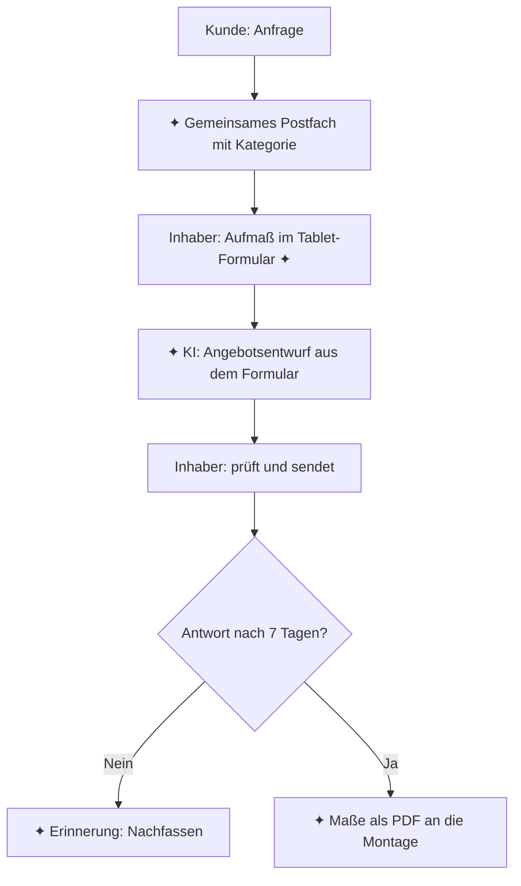

# Schritt 6 · Drei Lösungswege · fiktiv

> Fiktives Beispiel. Rolle der KI: „Berater für Digitalisierung im Handwerk“. Ausgabe gekürzt.

## A · Schnell und schlank: Ordnung mit dem, was da ist
Alle Anfragen landen in einem gemeinsamen Outlook-Postfach mit Kategorien. Eine Angebotsvorlage mit Textbausteinen ersetzt das freie Schreiben. Eine Outlook-Aufgabe „Nachfassen“ wird bei jedem Angebot nach sieben Tagen fällig. Bündelt Ideen 1, 4, 7, 12.
**Risiko:** Funktioniert nur, wenn der Inhaber die Disziplin durchhält.

## B · Ausgewogen: Aufmaß digital, Angebot vorbereitet
Aufmaß per Tablet-Formular mit Fotos. Eine KI erzeugt aus dem Formular einen Angebotsentwurf, den der Inhaber nur noch prüft. Die Maße gehen als PDF direkt an die Montage.

**Risiko:** Ein neues Formular – Akzeptanz im Team muss erst wachsen.

## C · Weitreichend: kleines CRM für Handwerker
Ein Handwerker-CRM mit Anfrage-Eingang, Angebot, Nachfassen und Auftragsübergabe in einem System. Zeigt auch, welche Kanäle Aufträge bringen.
**Risiko:** Genau die „neue Software, die keiner bedient“, die der Inhaber nicht will.
