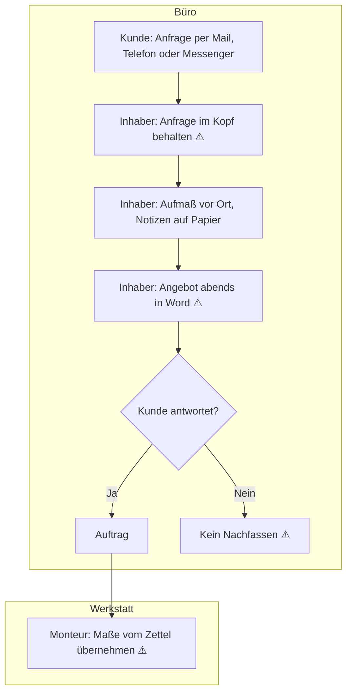

# Phase 1 · Ist-Analyse

**Ziel der Phase:** Du verstehst die Situation deines Gesprächspartners so genau, dass du sie ihm als Bild zurückgeben kannst – und er sagt: „Ja, genau so ist es.“

Vorher: [00 · Vorbereitung](00-prepare.md) (Einwilligung, Anonymisierung, Kontext-Block).

---

## Schritt 1 · Transkript erstellen

**Wer:** Mensch + Aufnahme-Werkzeug · **Ergebnis:** anonymisiertes Transkript als Text

Nimm das Gespräch mit Einwilligung auf und lass es transkribieren. Viele Videokonferenz- und Notiz-Werkzeuge können das inzwischen direkt. Exportiere das Transkript als Text und anonymisiere es (siehe Vorbereitung).

Wenn dein Werkzeug Sprecher nicht trennt, hilft dieser Prompt:

```text
{{KONTEXT}}

Das folgende Transkript hat keine oder falsche Sprecherwechsel. Ordne jede Passage dem wahrscheinlichen
Sprecher zu ([Ich] oder [Gesprächspartner], ggf. weitere Rollen). Wo du unsicher bist, markiere mit [?].
Ändere den Wortlaut nicht.

Transkript:
{{TRANSKRIPT}}
```

**Prüfen:** Stimmen die Sprecher? Sind wirklich alle Namen und Zahlen ersetzt?

---

## Schritt 2 · KI: Rechtschreibung und Grammatik prüfen

**Wer:** KI · **Ergebnis:** bereinigtes Transkript

Automatische Transkripte enthalten Hörfehler: Firmennamen werden zu Fantasiewörtern, Fachbegriffe zu Alltagswörtern. Das verfälscht jede spätere Analyse. Dieser Schritt korrigiert nur die Sprache, nicht den Inhalt.

```text
{{KONTEXT}}

Du bist ein genauer Lektor. Korrigiere im folgenden Transkript:
- offensichtliche Hörfehler der Spracherkennung (Fachbegriffe, Werkzeugnamen, Branchenbegriffe),
- Rechtschreibung, Grammatik und Zeichensetzung,
- Füllwörter nur dann, wenn sie den Sinn verdecken.

Regeln:
- Inhalt, Reihenfolge und Aussagen bleiben unverändert. Nichts hinzufügen, nichts weglassen, nichts glätten.
- Wo ein Wort unverständlich ist oder mehrere Deutungen möglich sind, schreibe [? Vorschlag].
- Gib danach eine kurze Liste der wichtigsten Korrekturen aus (vorher → nachher).

Transkript:
{{TRANSKRIPT}}
```

**Prüfen:** Lies die Korrekturliste. Jede [?]-Stelle klärst du selbst – du warst im Gespräch, die KI nicht.

---

## Schritt 3 · KI: Ist-Analyse und Anforderungen

**Wer:** KI · **Ergebnis:** strukturierte Ist-Analyse mit Belegen

```text
{{KONTEXT}}

Du bist ein erfahrener Business-Analyst. Analysiere das bereinigte Transkript und erstelle eine Ist-Analyse
mit genau diesen Abschnitten:

1. Ausgangslage in drei Sätzen.
2. Ziele des Gesprächspartners (wörtlich belegt).
3. Aktueller Ablauf: Schritt für Schritt, wer macht was mit welchem Werkzeug.
4. Schmerzpunkte: Was kostet Zeit, Geld, Nerven oder Kunden? Je Punkt ein kurzes wörtliches Zitat als Beleg.
5. Anforderungen, getrennt nach MUSS / SOLL / KANN.
6. Rahmenbedingungen: vorhandene Werkzeuge, Team, Budget-Signale (ohne Beträge), Zeitdruck.
7. Offene Fragen: Was wurde nicht gesagt, ist aber für eine Lösung nötig?

Regeln:
- Nur was im Transkript steht. Vermutungen kennzeichnest du mit „Annahme:“.
- Keine Lösungen in diesem Schritt.
- Einfache Worte.

Bereinigtes Transkript:
{{TRANSKRIPT_BEREINIGT}}
```

**Prüfen:** Hat jeder Schmerzpunkt ein echtes Zitat? Steht irgendwo eine Lösung, die nicht gefragt war? Die offenen Fragen sind deine Agenda für das nächste Gespräch.

> **Rollen-Tipp:** Lass dieselbe Analyse zusätzlich aus einer anderen Brille schreiben – Vertrieb, IT, Marketing, Service. Vorlagen: [Rollen](roles.md).

---

## Schritt 4 · KI: Ist-Prozess visualisieren

**Wer:** KI, dann Bestätigung durch den Gesprächspartner · **Ergebnis:** Ablaufdiagramm des heutigen Ablaufs

Ein Bild ist der schnellste Weg zu einem gemeinsamen Verständnis. Die KI schreibt das Diagramm als Mermaid-Code. Du fügst ihn in einen Mermaid-Editor ein (z. B. mermaid.live, oder direkt in Notion, GitHub, Obsidian) und siehst sofort das Diagramm. Viele Werkzeuge exportieren es als Bild oder in Visio-ähnliche Formate.

```text
{{KONTEXT}}

Erstelle aus der Ist-Analyse ein Ablaufdiagramm des HEUTIGEN Ablaufs als Mermaid-Code (flowchart TD).

Regeln:
- Jeder Kasten ist eine Tätigkeit: „Wer: Was“ (z. B. „Inhaber: Angebot in Word schreiben“).
- Entscheidungen als Raute mit Ja/Nein-Pfeilen.
- Gruppiere nach Abteilung oder Person mit subgraph.
- Markiere jeden Schmerzpunkt aus der Ist-Analyse mit ⚠ im Kasten.
- Maximal 15 Kästen. Lieber gröber und richtig als fein und falsch.
- Nur Mermaid-Code ausgeben, danach drei Fragen, mit denen ich das Bild mit meinem Gesprächspartner bestätigen kann.

Ist-Analyse:
{{IST_ANALYSE}}
```

**Prüfen:** Schick das Bild deinem Gesprächspartner mit genau einer Frage: „Habe ich deinen heutigen Ablauf richtig verstanden?“ Erst wenn er Ja sagt, geht es in Phase 2. Jede Korrektur von ihm ist Gold – sie zeigt, wo die KI (oder du) falsch lag.

Beispiel, wie so ein Diagramm aussieht (fiktiv):



Weiter: [Phase 2 · Lösung](02-phase-2-solution.md)
