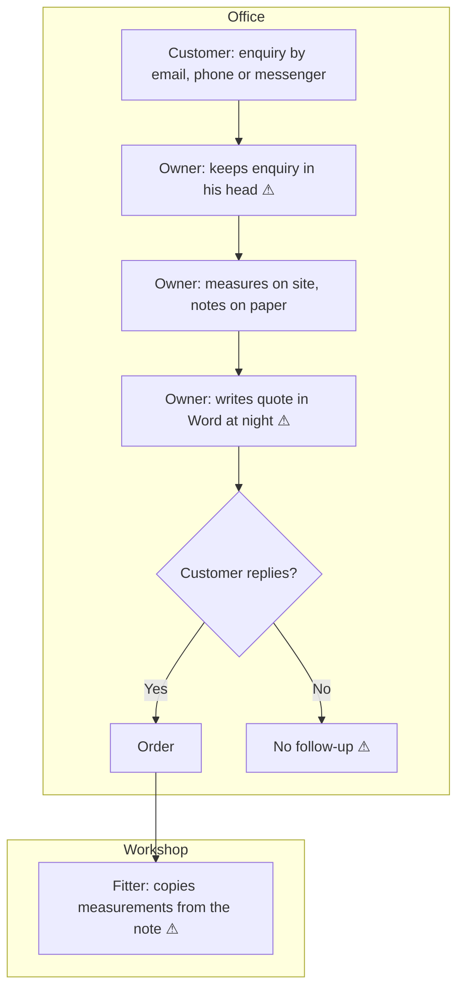

# Phase 1 · Current state

**Goal of this phase:** you understand the other person's situation so precisely that you can hand it back to them as a picture – and they say: "Yes, that's exactly how it is."

Before: [00 · Preparation](00-prepare.md) (consent, anonymisation, context block).

---

## Step 1 · Create the transcript

**Who:** human + recording tool · **Result:** anonymised transcript as text

Record the conversation with consent and have it transcribed. Many video-conferencing and note-taking tools can now do this directly. Export the transcript as text and anonymise it (see Preparation).

If your tool doesn't separate speakers, this prompt helps:

```text
{{CONTEXT}}

The following transcript has missing or wrong speaker changes. Assign each passage to the likely speaker
([Me] or [Other person], other roles if needed). Mark uncertain places with [?]. Do not change the wording.

Transcript:
{{TRANSCRIPT}}
```

**Check:** Are the speakers right? Have really all names and numbers been replaced?

---

## Step 2 · AI: check spelling and grammar

**Who:** AI · **Result:** cleaned transcript

Automatic transcripts contain mishearings: company names turn into made-up words, technical terms into everyday words. That distorts every later analysis. This step corrects only the language, not the content.

```text
{{CONTEXT}}

You are a meticulous editor. In the following transcript, correct:
- obvious speech-recognition mishearings (technical terms, tool names, industry terms),
- spelling, grammar and punctuation,
- filler words only where they obscure the meaning.

Rules:
- Content, order and statements stay unchanged. Add nothing, remove nothing, smooth nothing.
- Where a word is unintelligible or has several possible readings, write [? suggestion].
- Then output a short list of the most important corrections (before → after).

Transcript:
{{TRANSCRIPT}}
```

**Check:** Read the correction list. You resolve every [?] yourself – you were in the conversation, the AI wasn't.

---

## Step 3 · AI: current-state analysis and requirements

**Who:** AI · **Result:** structured analysis with evidence

```text
{{CONTEXT}}

You are an experienced business analyst. Analyse the cleaned transcript and write a current-state analysis
with exactly these sections:

1. Situation in three sentences.
2. The other person's goals (backed by quotes).
3. Current process: step by step, who does what with which tool.
4. Pain points: what costs time, money, nerves or customers? One short verbatim quote per point as evidence.
5. Requirements, split into MUST / SHOULD / COULD.
6. Constraints: existing tools, team, budget signals (no amounts), time pressure.
7. Open questions: what wasn't said but is needed for a solution?

Rules:
- Only what is in the transcript. Mark assumptions with "Assumption:".
- No solutions in this step.
- Simple words.

Cleaned transcript:
{{TRANSCRIPT_CLEAN}}
```

**Check:** Does every pain point have a real quote? Is there a solution anywhere that wasn't asked for? The open questions are your agenda for the next conversation.

> **Role tip:** have the same analysis written through another lens as well – sales, IT, marketing, service. Templates: [Roles](roles.md).

---

## Step 4 · AI: visualise the current process

**Who:** AI, then confirmation by the other person · **Result:** flow diagram of today's process

A picture is the fastest way to a shared understanding. The AI writes the diagram as Mermaid code. You paste it into a Mermaid editor (e.g. mermaid.live, or directly into Notion, GitHub, Obsidian) and see the diagram immediately. Many tools export it as an image or into Visio-like formats.

```text
{{CONTEXT}}

From the current-state analysis, create a flow diagram of TODAY's process as Mermaid code (flowchart TD).

Rules:
- Each box is an activity: "Who: what" (e.g. "Owner: writes quote in Word").
- Decisions as diamonds with yes/no arrows.
- Group by department or person with subgraph.
- Mark every pain point from the analysis with ⚠ in the box.
- At most 15 boxes. Coarse and right beats detailed and wrong.
- Output only Mermaid code, followed by three questions I can use to confirm the picture with the other person.

Current-state analysis:
{{CURRENT_STATE}}
```

**Check:** Send the picture to the other person with exactly one question: "Have I understood your current process correctly?" Only when they say yes do you move on to phase 2. Every correction from them is gold – it shows where the AI (or you) got it wrong.

What such a diagram looks like (fictional):



Next: [Phase 2 · Solution](02-phase-2-solution.md)
