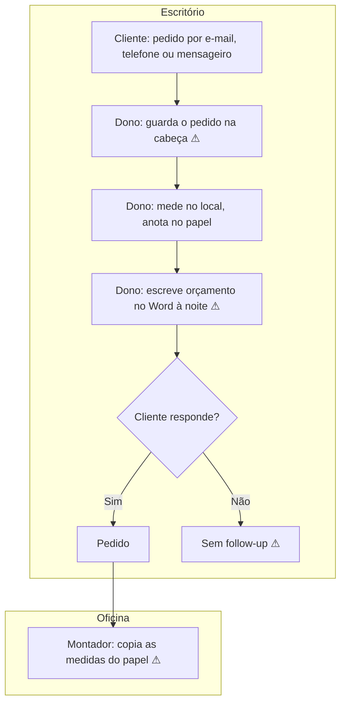

# Fase 1 · Situação atual

**Objetivo da fase:** você entende a situação da outra pessoa com tanta precisão que consegue devolvê-la como uma imagem – e ela diz: "Sim, é exatamente assim."

Antes: [00 · Preparação](00-prepare.md) (consentimento, anonimização, bloco de contexto).

---

## Passo 1 · Criar a transcrição

**Quem:** humano + ferramenta de gravação · **Resultado:** transcrição anonimizada em texto

Grave a conversa com consentimento e mande transcrever. Muitas ferramentas de videoconferência e de anotações já fazem isso diretamente. Exporte a transcrição como texto e anonimize-a (veja Preparação).

Se a sua ferramenta não separa os interlocutores, este prompt ajuda:

```text
{{CONTEXTO}}

A transcrição abaixo não tem trocas de interlocutor ou elas estão erradas. Atribua cada trecho ao provável
interlocutor ([Eu] ou [Interlocutor], outros papéis se necessário). Marque trechos incertos com [?].
Não altere o texto.

Transcrição:
{{TRANSCRICAO}}
```

**Revisar:** os interlocutores estão corretos? Todos os nomes e números foram mesmo substituídos?

---

## Passo 2 · IA: revisar ortografia e gramática

**Quem:** IA · **Resultado:** transcrição limpa

Transcrições automáticas contêm erros de audição: nomes de empresas viram palavras inventadas, termos técnicos viram palavras do dia a dia. Isso distorce toda análise posterior. Este passo corrige apenas a linguagem, não o conteúdo.

```text
{{CONTEXTO}}

Você é um revisor minucioso. Na transcrição abaixo, corrija:
- erros evidentes do reconhecimento de voz (termos técnicos, nomes de ferramentas, termos do setor),
- ortografia, gramática e pontuação,
- palavras de preenchimento apenas quando escondem o sentido.

Regras:
- Conteúdo, ordem e afirmações permanecem iguais. Não acrescente, não omita, não suavize nada.
- Onde uma palavra for incompreensível ou tiver várias leituras possíveis, escreva [? sugestão].
- Depois, gere uma lista curta das correções mais importantes (antes → depois).

Transcrição:
{{TRANSCRICAO}}
```

**Revisar:** leia a lista de correções. Cada [?] você esclarece sozinho – você estava na conversa, a IA não.

---

## Passo 3 · IA: análise da situação atual e requisitos

**Quem:** IA · **Resultado:** análise estruturada com evidências

```text
{{CONTEXTO}}

Você é um analista de negócios experiente. Analise a transcrição limpa e escreva uma análise da situação
atual com exatamente estas seções:

1. Situação em três frases.
2. Objetivos da outra pessoa (com citações).
3. Processo atual: passo a passo, quem faz o quê com qual ferramenta.
4. Pontos de dor: o que custa tempo, dinheiro, nervos ou clientes? Uma citação literal curta por ponto como evidência.
5. Requisitos, separados em DEVE / DEVERIA / PODERIA.
6. Condições: ferramentas existentes, equipe, sinais de orçamento (sem valores), urgência.
7. Perguntas em aberto: o que não foi dito, mas é necessário para uma solução?

Regras:
- Apenas o que está na transcrição. Marque suposições com "Suposição:".
- Nenhuma solução neste passo.
- Palavras simples.

Transcrição limpa:
{{TRANSCRICAO_LIMPA}}
```

**Revisar:** cada ponto de dor tem uma citação real? Aparece alguma solução que não foi pedida? As perguntas em aberto são a sua pauta para a próxima conversa.

> **Dica de papéis:** peça a mesma análise também por outra lente – vendas, TI, marketing, atendimento. Modelos: [Papéis](roles.md).

---

## Passo 4 · IA: visualizar o processo atual

**Quem:** IA, depois confirmação pela outra pessoa · **Resultado:** fluxograma do processo de hoje

Uma imagem é o caminho mais rápido para um entendimento comum. A IA escreve o diagrama como código Mermaid. Você o cola num editor Mermaid (por exemplo mermaid.live, ou diretamente no Notion, GitHub, Obsidian) e vê o diagrama na hora. Muitas ferramentas exportam como imagem ou em formatos parecidos com o Visio.

```text
{{CONTEXTO}}

A partir da análise da situação atual, crie um fluxograma do processo de HOJE como código Mermaid (flowchart TD).

Regras:
- Cada caixa é uma atividade: "Quem: o quê" (por exemplo "Dono: escreve orçamento no Word").
- Decisões como losangos com setas sim/não.
- Agrupe por área ou pessoa com subgraph.
- Marque cada ponto de dor da análise com ⚠ na caixa.
- No máximo 15 caixas. Melhor grosseiro e certo do que detalhado e errado.
- Gere apenas código Mermaid e, em seguida, três perguntas com as quais posso confirmar a imagem com a outra pessoa.

Análise da situação atual:
{{SITUACAO_ATUAL}}
```

**Revisar:** envie a imagem para a outra pessoa com exatamente uma pergunta: "Entendi corretamente o seu processo atual?" Só quando ela disser sim você passa para a fase 2. Cada correção dela vale ouro – mostra onde a IA (ou você) errou.

Como fica um diagrama assim (fictício):



Próximo: [Fase 2 · Solução](02-phase-2-solution.md)
